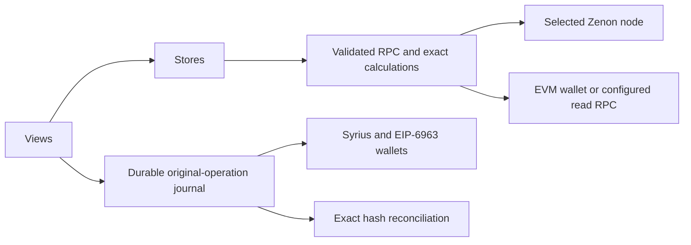

# Architecture

The static Vue application reads Zenon JSON-RPC and EVM contracts. Wallets sign and publish transactions; the application never stores private keys. Core calculations, RPC validation, context ownership, durable operation evidence and views are separate modules.

## Read ownership

Node epochs and API ownership distinguish a retired connection from the active one. A subscribed momentum can contain only hash/height; its full timestamp and chain identity are fetched and validated before committing. Disconnect cancels RPC waiters, HTTP requests, polling and reconnection. A call has one whole twenty-second deadline.

Routes use network class, EVM chain, bridge contract, Zenon token standard and EVM token address as their identity. Configuration and health reads commit atomically only for their captured context. Missing EVM metadata, chain identity, halted contracts, key or decimal mismatches close the route. Unknown or stale health closes new sends; an explicit degraded-service override cannot override missing configuration or identity.

| Read | Scope and bound |
|---|---|
| Node frontier | Correct chain, no more than 120 seconds old or 60 seconds ahead |
| Bridge configuration and health | Captured node context; safety lifetime 180 seconds |
| Address history | Stable count, up to 100 pages of 100 records; four reads per history family |
| Network/token metadata | Two network tasks and two token tasks per network |
| Redeem state | Current reader chain, exact ID, fresh EVM head; unread state is unavailable |
| Health observation | At most 100 unsigned requests and 300 recent bridge blocks; sample bounds visible |
| Pool/stake data | Captured account/provider/node/program identity; fresh read before signing |

Changing nodes, chains, accounts or providers invalidates current action readiness. An old response cannot populate a new scope. Failed history reads retain dated rows with an explicit error. Known unresolved operations are reconciled independently of address-history availability. Amounts use integer arithmetic; ambiguous comma separators and excess precision are refused.

## Publication ownership

The chosen source chain, account, contract, amount, recipient, referral and calldata are captured before awaiting approval. Form controls stay frozen during the operation. Source and economic configuration are checked again before every wallet prompt, including a prompt delayed by the Syrius exclusive queue.

`bridge.operations.v1` is saved and read back before wallet invocation. Secure-context Web Locks serialize publication across tabs. Missing lock support or unreadable storage prevents signing. An unresolved journal record blocks a second operation for the same source/account/chain after reload or tab closure. Other-tab records are merged without discarding original hashes.

Only the original promise or the exact original hash can resolve an unknown outcome. Zenon recovery verifies chosen fields, computed hash, signature, public key/account and confirmation. EVM recovery verifies the original transaction, receipt, canonical block, reader chain and two confirmations. These reads trust the chosen RPC; they are not a light-client finality proof. A mismatch requires independent review. No replacement, nonce discovery or fuzzy history search is performed.

## Actions and completion

| Action | Publication | Completion check |
|---|---|---|
| Wrap | Zenon `WrapToken` | Exact request, signature and later EVM redeem steps |
| Redeem wrap | EVM `redeem`, twice with delay | Successful original receipt and expected `redeemsInfo` step |
| Unwrap | EVM approval then `unwrap` | Allowance, successful original receipt, exact transaction/log request |
| Redeem unwrap | Zenon `Redeem` | Submission shown separately from later request state |
| Add liquidity | EVM approval then router call | Allowance, successful original receipt and increased LP balance |
| Stake/cancel/collect | Zenon liquidity calls | Submission shown separately; fresh program/expiry/reward state |

New stakes are paused when rewards are zero. A successful source transaction does not establish opposite-chain completion, TSS availability or irreversible finality. The one-key lab models messages and contract calls; production ceremonies and integration acceptance remain separate.

## Browser and deployment

Views and reconciliation load lazily. Fonts, scripts and icons are local. Hash routes support static hosting. Navigation adapts below desktop width; nested dialogs own focus/Escape, make the background inert and restore focus/scroll. Reduced-motion preferences are honored.

The HTML declares CSP/referrer policy; the legacy affiliate landing page accepts only same-origin destinations without userinfo. Framing and transport headers require hosting-owner configuration. See [deployment gates](DEPLOY.md), [recovery](RECOVERY.md), [testing](TESTING.md), [support](SUPPORT.md) and [provenance](PROVENANCE.md).
