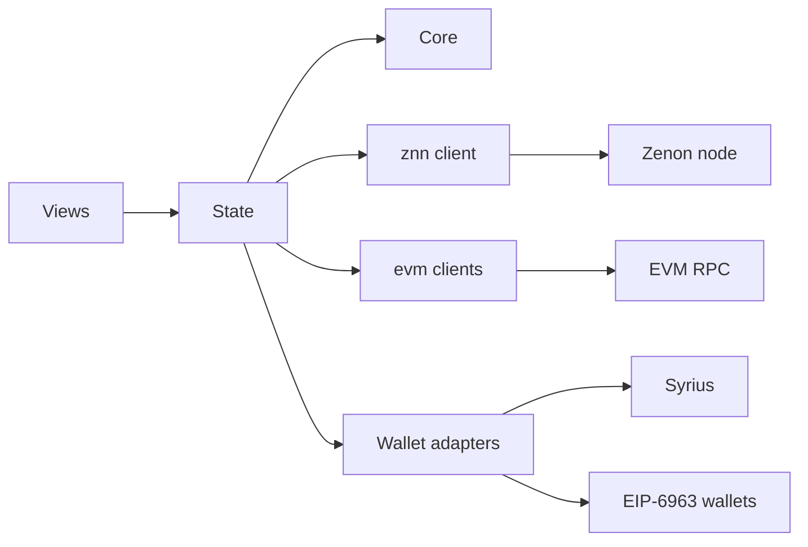
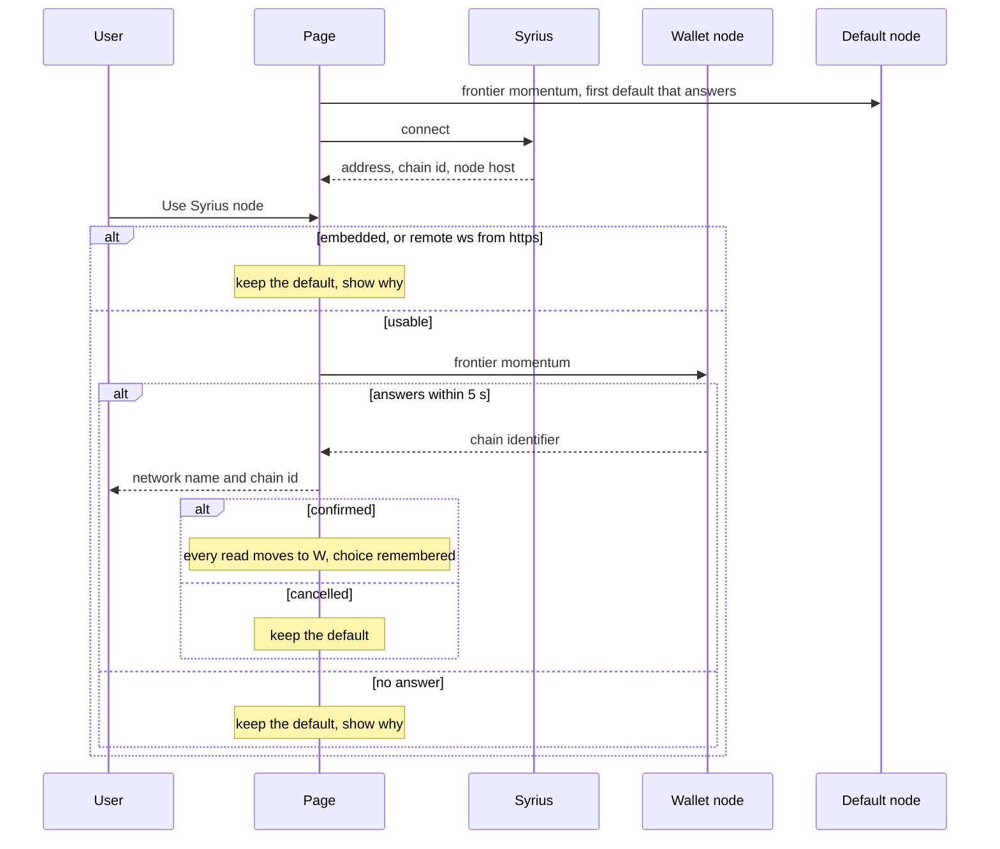
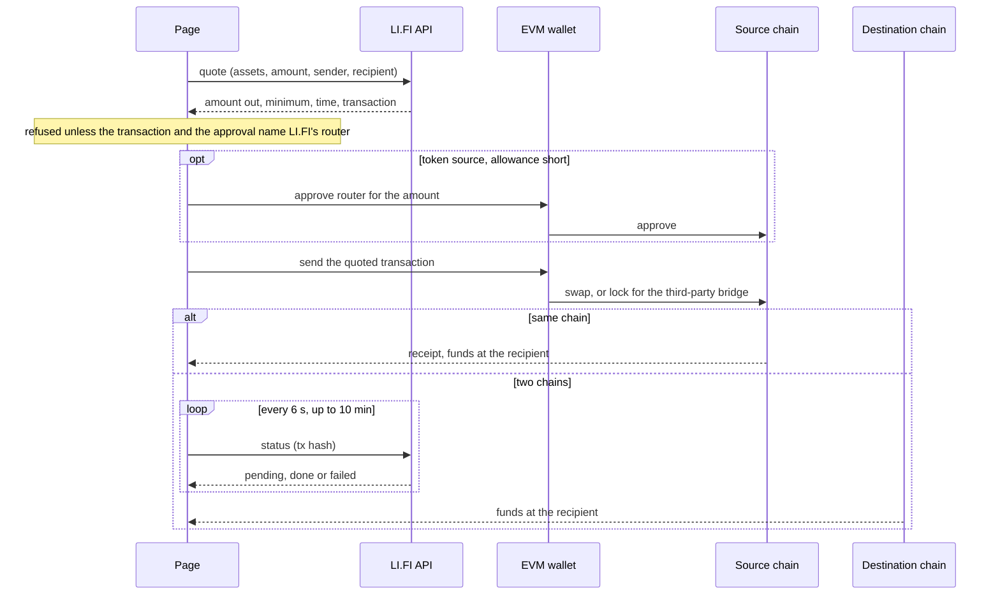

# Architecture

A static Vue 3 app. Everything it shows comes from two places: a Zenon node
(JSON-RPC over WebSocket) and the EVM chains (through the user's wallet, or a
public RPC when there is none).

- **core/** is pure: no network, no Vue. Fees, status mapping, referral codes,
  orchestrator health, the plasma bot call. This is what the unit tests cover
  most.
- **state/** holds one reactive store per concern and refreshes on the
  momentum beat (`node.tick`), so a page never polls on its own timer.
- **views/** read state and call wallets. No view talks to a node directly.

## Reads

| Data | From | Refresh |
|---|---|---|
| Momentum height and rate | `ledger.subscribe('momentums')`, timestamp read per momentum | live |
| Bridge switches, networks, pairs | `embedded.bridge.*` | 90 s |
| EVM side of each pair | `tokensInfo`, ERC-20 `symbol`/`decimals` on each bridge | 90 s |
| Orchestrator health | unsigned wraps, last 300 bridge blocks, pillar list | 2 min |
| Activity | requests by recipient, EVM `redeemsInfo` | 30 s while pending |

Networks and pairs are never hardcoded: a pair added on chain appears without a
release. `src/config.ts` holds only what the chain cannot say: explorers,
fallback RPCs, default nodes, the Uniswap pool.

## Which node

The page reads from the default node (`wss://my.hc1node.com:35998` on mainnet,
with one fallback). The node Syrius reports is used only when the user turns on
"Use Syrius node" in the Syrius menu and confirms the network that node says it
is on. That node decides what the page shows, so the user is told which network
it is before anything is read from it: chain 1 is Mainnet, 3 is Testnet, any
other identifier is a devnet.

The choice is stored with the chain identifier it was confirmed for. It is
restored on a later visit only while Syrius still names that node and the node
is still on that chain; otherwise the page goes back to the default and says so.

## Any chain

Nothing is tied to chain 1. On whichever chain the node is on, the page reads
the embedded bridge contract for its networks, EVM bridge addresses, token
pairs, fees and delays, and builds account blocks with that chain's identifier.
What the chain cannot say is skipped off the build's own chain: explorer links,
the plasma bot and the Uniswap pool. An EVM chain the build has no RPC for is
read through the connected EVM wallet once it is on that chain. Transfers
remembered in the browser carry their Zenon chain identifier and show only on
that chain.

## Orchestrator status

There is no public orchestrator monitor any more (status.bridge.zenon.community
is gone), and the orchestrators' own health endpoints are private. The status
is derived from the chain:

- Orchestrators send `UpdateWrapRequest` and `UnwrapToken` from their pillar's
  producer address, rotating by request id. The bridge contract's receive
  blocks show who sent each one and when. Mapping producers to pillars gives
  "seen signing".
- `getAllUnsignedWrapTokenRequests` lists wraps without a signature. One past
  finality for six hours means the ceremony is not happening.

The verdict, in order: halted, key generation, stalled (6 h), delayed (1 h),
online (a signature in the last 24 h), idle. Halted, key generation and
stalled show the red banner on every page and put a "Send anyway" checkbox
in front of the Bridge button. Thresholds are in `src/core/orchestrators.ts`.

## Writes

Every write is signed by the user's wallet.

| Action | Wallet | Call |
|---|---|---|
| Wrap | Syrius | send to the bridge contract, `WrapToken(class, chainId, to)` |
| Redeem a wrap | EVM | `redeem(to, token, amount - fee, id, sig)` twice, `redeemDelay` blocks apart |
| Unwrap | EVM | `approve` if short, then `unwrap(token, amount, "z1…[&z1referrer]")` |
| Redeem an unwrap | Syrius | `Redeem(txHash, logIndex)` |
| Stake LP | Syrius | send to the liquidity contract, `LiquidityStake(seconds)` |
| Revoke, collect | Syrius | `CancelLiquidityStake(id)`, `CollectReward()` |
| Add liquidity | EVM | `approve`, `addLiquidityETH` on the Uniswap V2 router |
| Swap | EVM | `approve` if short, then the transaction LI.FI quoted, to its router |

A redeem simulates first, so bridge.sol's revert reason ("not redeemable yet",
"nonce already redeemed") is shown instead of a failed transaction.

## Swaps

An EVM asset can go to another EVM asset, on the same chain or on the other
one, without the bridge: ETH to wZNN, wZNN on Ethereum to BNB, and so on. The
assets are each chain's coin and the bridge's own tokens there, less pool
shares. `src/core/swap.ts` asks LI.FI (`li.quest/v1/quote`) for a route; LI.FI
is the aggregator Jumper and MetaMask's bridge use, it answers a browser with
no key, and it already routes wZNN. It picks the DEX or the third-party bridge.
Calling 1inch or Uniswap directly was set aside: 1inch's API needs a key and
refuses browsers, and a Uniswap router call covers one chain only.

What changes on the page for a swap: Syrius is not asked for, the time shown is
the quote's (seconds, not the bridge's half hour), the recipient is an EVM
address and can still be a custom one, the bridge-down block does not apply,
and the details list the route, the minimum received and the fee in dollars.

Limits. The quote is asked for when an input settles, not on a timer, because
the unkeyed API allows 75 per two hours per address. A quote older than a
minute is asked for again on send, and a worse one is shown before anything is
signed. A swap is not a bridge request, so Activity does not list it: it is
followed with toasts in the tab that sent it, and a reload loses that. LI.FI
takes a fee on every route, shown in the details.

## Design

Zenon design tokens transcribed into `src/style.css` (Tailwind 4, CSS-first),
self-hosted Space Grotesk and JetBrains Mono, Lucide icons. Rules from
`webdesign-lab/RULES.md`: amounts and ids mono and tabular, status as icon plus
word, the plasma gradient once per view on the main action, light and dark, one
700 px breakpoint, 44 px hit areas, nothing from a CDN, and motion that always
runs.

## Decisions

| Decision | Why |
|---|---|
| No znn-ts-sdk | It pulls ethers 5 and Node polyfills; the noble-based primitives from the ptlc lab are a few hundred lines |
| WebSocket to the node | Public nodes speak it, it carries the subscription, and it needs no CORS preflight |
| Hash routes | Pages has no SPA fallback |
| Large integers parsed as strings | go-zenon sends some amounts as bare JSON numbers past 2^53 (`parseJsonSafe`) |
| Referral suffix is the decoded address | The orchestrator parses it as an address; the original sent the mangled code on a first visit |
| `affiliate.html` follows only http(s) | The original followed any `originURL`, including `javascript:` |
