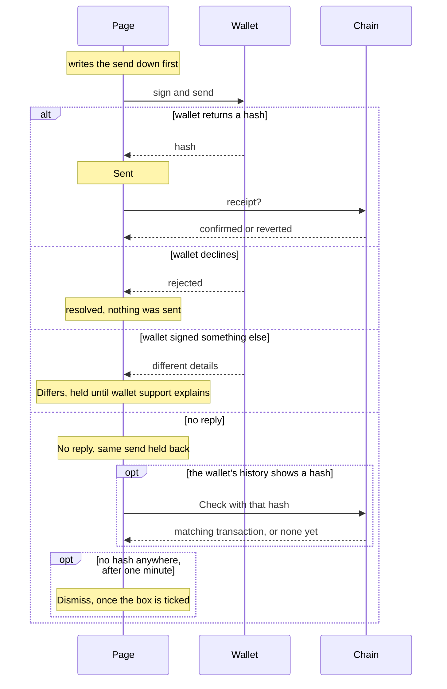

# Unconfirmed sends

Before it asks a wallet to sign, the page writes the send down: chain,
account, contract, calldata and amount, in `bridge.operations.v1` in this
browser. If the wallet never answers, the page still knows exactly what it
asked for, and holds back the same send from that account and chain until the
first one is accounted for. A wallet timeout, a lost reply or a missing receipt
does not prove the send was rejected: it may still land.

The browser keeps transaction details only, never keys or seed phrases.

## What to do

1. Open **Activity**. Sends the wallet never confirmed are listed under
   **Unconfirmed**.
2. Look for the send in the wallet's pending transactions and history.
3. If the wallet shows a hash, paste it and press **Check**. The page accepts
   it only if the transaction is the one it asked for: same account, chain,
   contract, calldata and amount. A Zenon block must also match its computed
   hash, public key, signature and confirmation. An EVM transaction needs a
   receipt on a canonical block and two confirmations. That proves the send
   landed, not that the bridge has finished the transfer.
4. If the wallet shows nothing, close its prompt, wait a minute, tick **Not in
   my wallet's pending or history** and press **Dismiss**. The record stays,
   across reloads. The identical send stays held back, even with a fresh quote
   or another router. A different send is allowed. If the original hash turns
   up later, the hold comes back until that transaction is checked.
5. Do not sign a replacement, change a nonce or send again to make up for an
   unknown outcome. Do not take a hash from a similar entry in an address's
   history: only the original wallet request's hash counts.

| Shown | Stored as | Means | What clears it |
|---|---|---|---|
| In wallet | `awaiting-wallet` | The wallet prompt is open | The wallet's reply |
| No reply | `unknown` | The outcome is not known | Check with the hash, or Dismiss after a minute when there is none |
| Sent | `submitted` | The hash is known, the receipt is not | Check |
| Differs | `mismatch` | The wallet sent other details than the page asked for | Nothing in the page: wallet support and a maintainer |

Confirmed, reverted and declined sends leave the list. An approval must also
show the allowance, adding liquidity must show the LP balance rise, and an EVM
redeem must show its step, before the page treats them as done.

## Another tab

Web Locks keep two tabs from raising wallet prompts at once. A browser without
them, or a page on plain HTTP, cannot sign. While another tab holds a prompt,
Dismiss is refused until that prompt closes. A reply that arrives late is recorded against the
original send, whichever screen, account or chain is showing by then.

## When saved history can't be read

Sending pauses. Activity then offers **Download and reset**: it saves the
unreadable record to a file, then clears it, and sending resumes. Keep that
file, and keep it private: it holds addresses, amounts, recipients and node
details. The reset lifts the hold on anything the record held, so check the
wallet's history before sending the same thing again. The button only appears
when the stored record fails to read; a readable one is never offered it.

## Swaps

A swap's approval and send keep the quote with them: assets, recipient, amount,
minimum out and expiry. A confirmed swap proves the source transaction only.
The router's status is not a receipt on the receiving chain.

## Limits

Address history reads at most 100 pages of 100 entries. A count that changes
while reading gives an error, not a partial list. Checking a send by its hash
does not depend on that history. Unresolved sends are always kept; only old
resolved ones are trimmed. Activity rows saved before the Zenon chain was
recorded are taken to be on the build's chain; check their real chain before
using them elsewhere. A change of chain or account drops cached reads, and a
redeem needs a fresh read.
