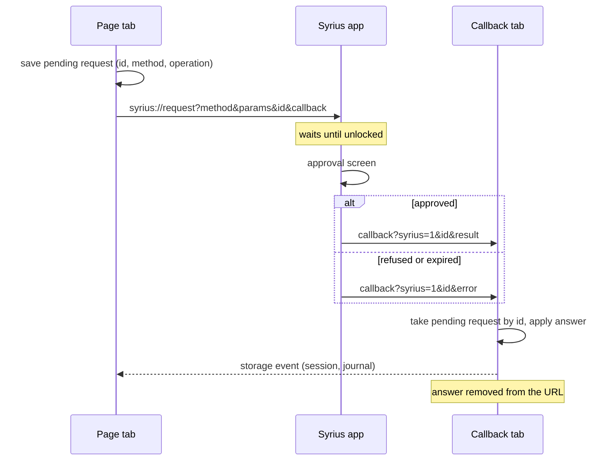

# Syrius

The page signs every Zenon block through Syrius. There are three Syrius
transports in the field, and the page speaks all of them. It picks one when it
loads, in this order:

| Found | Transport | Versions | Code |
|---|---|---|---|
| `window.zenon.sendAccountBlock` | Provider (`version: 2`): `connect`, `sendAccountBlock`, events | Extension 0.3.0 and later | `src/wallet/syrius.ts` |
| The v0.1.x `<script>` element | `window.postMessage` relay | Extension 0.1.x | `src/wallet/syriusLegacy.ts` |
| Neither, on a phone | `syrius://request` links, answered by a callback to the page | Phone app 0.3.6 and later | `src/wallet/syriusApp.ts` |
| Neither, on a desktop | Install link to the releases | | |

v0.1.x adds an inline script that sets `window.zenon.isSyriusExtension`. The
page's CSP (`script-src 'self'`) blocks it, so the flag never appears; the
element is still in the DOM and its text is what the page looks for. The relay
itself runs in the content script and is not affected by the CSP.

## Tested

Each run imports the devnet mnemonic through the wallet's own screens, points
the wallet at the lab node (chain 322), selects account index 3, then on the
bridge page connects, wraps 2 ZNN and approves the block in the wallet. A run
passes when the journal holds the send as `submitted` with the wallet's hash
and that block is on the lab node from the right account and chain.
Account 3 has no plasma, so every send also exercises the wallet's PoW.

| Version | Browser | Result |
|---|---|---|
| Extension 0.1.9 | Chrome for Testing 130, MV2 re-enabled | Pass. PoW took 6.5 min |
| Extension 0.1.8 (any chain) | Chrome for Testing 130, MV2 re-enabled | Pass |
| Extension 0.1.9 | Firefox ESR 153 | Fails in the wallet: it cannot open its approval window |
| Extension 0.3.0, 0.3.1, 0.3.2, 0.3.3, 0.3.5, 0.3.6, 0.3.7 | Chromium 156 | Pass |
| Extension master (15bb157) | Chromium 156 | Pass |
| App 0.3.6, 0.3.7 web build | Chromium 156, Android user agent | Pass: connect, chain check, wrap |
| App master web build | Chromium 156, Android user agent | Pass: connect, chain check, wrap. PoW took 134 s |

Release zips are the published ones with their digests checked; master and the
app builds were built from `sol-znn/syrius-extension` with
`SYRIUS_PLATFORM=android`.

### What is not proven

- **A phone.** The app was run as its web build (`build-app/`) in desktop
  Chromium, the same code the Android and iOS shells load. Capacitor's link
  handling and the system browser were stood in for: the link was handed to
  `window.syriusAppLinks.receive`, which is what the app's `appUrlOpen`
  listener calls, and the answer came back through `AppLauncher.openUrl`, which
  in a web build is `window.open`. No emulator (no KVM on the test host) and no
  iOS (no macOS).
- **Firefox with 0.1.x.** The wallet's background page calls `window.open` for
  its approval, and Firefox returns `null` there, so no request can be
  approved. The page detects the wallet and the request reaches it; the failure
  is the wallet's. 0.3.x is the version to use in Firefox.
- **0.1.x in current Chrome.** Chrome no longer loads MV2 extensions, so 0.1.x
  only runs in an old Chrome or one with MV2 re-enabled. It is tested because
  people still have it installed in such browsers.

## The phone path

A phone has no extension. The page sends the person to the app with a link and
the app answers by opening the page again with the answer in its query.



- **Connect** (`znn_connect`) returns the address. The page then needs the
  chain, so it shows "Check the network Syrius is on." with a button that sends
  `znn_chainId`. Sends stay blocked until the chain matches the build's.
- **Send** (`znn_signAndSendBlock`) carries the journal's operation id. The
  operation is written before the link opens, so a page that is closed while
  the app works still knows a send may have happened. The answer moves it to
  `submitted` with the hash, to `rejected` on a refusal (4001, 4100, -32602,
  -32005, -32006), to `mismatch` when the returned block is not the one asked
  for, and leaves it `unknown` otherwise, for recovery to settle.
- The answer may land in a new tab (a phone's browser often opens one) or the
  same one. Either way it is applied once, by whichever tab finds it, and the
  other tabs follow through storage.
- Pending requests expire after 35 minutes; an answer with an unknown id says
  "Syrius answer expired" and changes nothing.
- 4100 (not connected) clears the saved session, so the page asks to connect
  again.

## PoW

An account without plasma makes the wallet compute PoW before it can publish.
The page warns ("No plasma. Sending will be slow.") and waits: 5 minutes for
a v0.1.x connect, 10 minutes for a v0.1.x send, the provider's own deadline
for 0.3.x, and the app's for the phone. A send that outlives the page's
deadline is not lost: the operation stays `unknown` and the account chain is
checked for it ([RECOVERY](RECOVERY.md)).

## Rerunning

The drivers in `e2e/syrius/` are Node scripts on `puppeteer-core` (Chromium)
and a small Marionette client (Firefox). They need the lab from
[TESTING](TESTING.md) running, the page served with `VITE_NETWORK=devnet`
(`BRIDGE_URL`, default `http://127.0.0.1:4174/`), and a browser that shares the
lab's loopback. Logs and screenshots go to `e2e/.state/syrius/<label>/`
(`RESULTS_DIR`). Each run spends 2 ZNN from account 3, so run one at a time.

```
node e2e/syrius/matrix.mjs     <label> <unpacked 0.3.x extension>    # CHROMIUM_PATH
node e2e/syrius/matrix-mv2.mjs <label> <unpacked 0.1.x extension>    # CHROME_MV2_PATH
node e2e/syrius/matrix-ff.mjs  <label> <0.1.x with a gecko id> <id>  # FIREFOX_PATH
node e2e/syrius/matrix-app.mjs <label> <build-app directory>         # CHROMIUM_PATH
node e2e/syrius/nodes.mjs                                            # the Node menu
```
