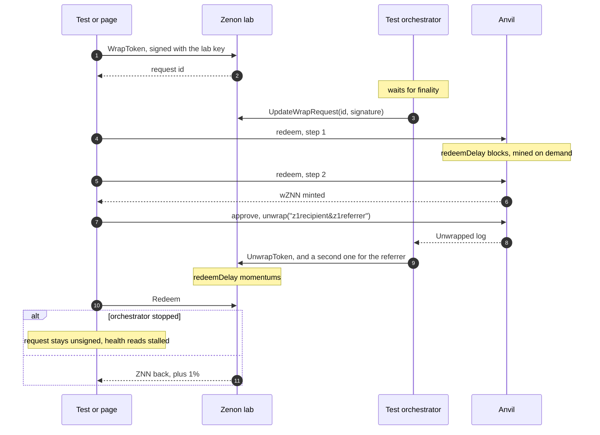

# Testing

Two suites. The unit tests run anywhere in a second. The end-to-end tests run
the bridge for real on a private devnet: both contracts, a test orchestrator,
and the page in a browser.

```sh
npm test               # unit
npm run lab:up         # start the devnet and anvil (first run builds znnd)
npm run test:e2e       # end to end, several minutes
npm run lab:down       # stop it
```

## Unit tests

`tests/unit/`, vitest, no network. They hold fixtures read from mainnet, so
the encodings are checked against what the chain accepted rather than against
themselves.

| File | Checks |
|---|---|
| `abi.test.ts` | Method ids equal the selectors on the mainnet bridge chain; `WrapToken` and `Redeem` call data byte for byte equal to mainnet blocks; liquidity calls |
| `signatures.test.ts` | A wrap signed by the mainnet orchestrators recovers to the bridge's TSS key through the app's message layout and `evmSignature` |
| `referral.test.ts` | Codes equal the original app's; first referral wins; the unwrap suffix is the decoded address |
| `core.test.ts` | Fees (against a real mainnet wrap), formatting, wrap and unwrap status, revert reasons, affiliate metadata, the plasma bot call, big-integer JSON |
| `swap.test.ts` | Each router's request and the reading of its answer (shapes recorded 2026-10-13); a quote naming any contract but that router's, or another amount, is refused and not shopped elsewhere; KyberSwap on one chain, Across on two, LI.FI as the fallback; transfer status, time, prices |
| `errors.test.ts` | Thrown errors as shown: viem's wallet rejection text becomes "Declined in wallet", wallet states name the remedy, a revert shows the contract's reason, anything else is one line of 80 characters |
| `orchestrators.test.ts` | The health verdict: halted, key generation, stalled (mainnet as read on 2026-10-12), delayed, online, idle |

## End to end

Mainnet cannot be used: its orchestrators stopped signing in August 2026, and
a test should not move real funds. So `e2e/` brings up the whole bridge on a
lab.



### The lab (`e2e/lab/`)

`lab.sh` builds and runs it with Docker. It follows the syrius-extension lab:
its own compose project, containers, subnet, ports and chain identifier, so it
shares nothing with another devnet on the machine.

| | |
|---|---|
| Zenon | go-zenon's five-node devnet, chain 322, RPC on `127.0.0.1:46997` (HTTP) and `46998` (WS) |
| EVM | anvil, chain 31337, on `127.0.0.1:46545`, a fresh chain every start |
| Image | `bridge-lab-znnd:<go-zenon commit>-bridge` |

A stock go-zenon devnet cannot run the bridge, for two reasons, and the lab
changes exactly those:

1. The `bridge-liq` spork is off in the devnet genesis. `make-assets.mjs` turns
   it on from genesis, as `az` and `htlc` already are.
2. The bridge administrator is an address compiled into znnd, and its time
   challenges last one and two days. `znnd/devnet_bridge.go` is added to the
   build: when `ZNN_DEVNET_BRIDGE=1` it takes the administrator from
   `ZNN_BRIDGE_ADMIN` and shortens the delays to one and two momentums. This
   is what go-zenon's own bridge tests do in process. The file is not part of
   go-zenon and does nothing without the variable.

`GO_ZENON_DIR` points at the go-zenon checkout (default `../go-zenon`, beside
this repository).

### What runs

`e2e/setup.ts` deploys HyperCore's `bridge.sol` (vendored unchanged in
`e2e/contracts/`, the contract mainnet runs) and a mintable test token on
anvil, registers the token and the TSS key, then on Zenon sets the
orchestrator info, the TSS key, the network and the ZNN pair. Each step is
skipped when the chain already has it.

`e2e/orchestrator.ts` is a single-key stand-in for the orchestrator network.
It signs the same messages and makes the same contract calls; only the
threshold ceremony is missing. Its message code is the code the unit tests
check against a mainnet signature.

| File | Covers |
|---|---|
| `bridge.e2e.test.ts` | Wrap and both EVM redeems, unwrap through a referral with both Zenon redeems, exact balances on both chains, every status the app derives on the way, and the health verdict going stalled and back |
| `ui.e2e.test.ts` | The page in headless Chrome with a mock Syrius provider and a mock EIP-6963 wallet: connect, terms, wrap, redeem twice from Activity, approve and unwrap, redeem on Zenon, Stats online, no console errors, no overflow |

The protocol test builds every block and transaction with the app's own
functions and reads every state through the app's own client, so a failure
there is a failure in what the page would do.

### Swaps on a mainnet fork (`e2e/swap.fork.mjs`)

Swaps cannot run on the lab: the routers quote mainnet. This script drives the
page in headless Chrome with a mock EIP-6963 wallet that forwards to an anvil
fork of Ethereum, so the quoted transactions really execute:

```
docker run -d --rm --name swap-fork -p 46599:8545 --entrypoint anvil \
  ghcr.io/foundry-rs/foundry:stable --host 0.0.0.0 --chain-id 1 \
  --fork-url https://ethereum-rpc.publicnode.com
npm run test:swap
docker rm -f swap-fork
```

It checks the dollar estimates, the unfiltered pickers, a wallet refusal
reading "Declined in wallet", no terms prompt, ETH to wZNN and back through
KyberSwap with an approve and a custom recipient, and the sending half of ETH
to BNB through Across. It calls the live router APIs, so it is not part of
`npm test`, and arrival on the other chain is beyond what a fork can show.
Start a fresh fork for each run: the routers quote live prices, and an old
fork drifts from them.

### Limits

- One key plays administrator, orchestrator and user on Zenon (devnet index
  1, the only account with plasma in genesis), so sends are serialised.
- Momentums take about 15 s on Docker Desktop. The suites take several
  minutes each.
- The liquidity contract and the Uniswap pool are not in the lab; those flows
  are covered by unit tests of their call data only.
- The real Syrius extension and real EVM wallets are not driven. The mocks
  follow their provider interfaces.
